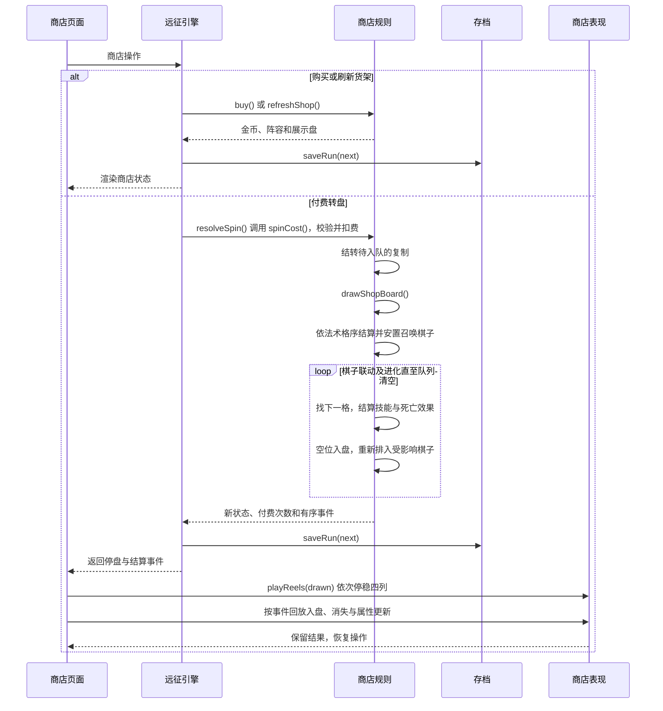

# ROLLBOUND 商店轮盘改造方案

**修订设计稿 · 2026 年 11 月 22 日**

开发基线为 GitHub 的 `stable-v2`，指向当前线上源码提交 `1a46fab`。[稳定版二](https://github.com/saiqi1999/ROLLBOUND/tree/stable-v2)

桌面商店以左侧的 **4×4 自有阵容轮盘**为视觉中心，右侧是货架。玩家用同一笔金币决定招募、转盘或刷新货架。四列依次停稳后回放联动。开战时从所有已招募且仍在队伍中的单位随机抽取首发，其余进入候补。战斗界面集中呈现走位、伤害、治疗、召唤和补员。[《背包乱斗》参考](https://store.steampowered.com/app/2427700/Backpack_Battles/)

## 1. 新的核心循环

| 阶段 | 玩家看到什么 | 玩家做什么 | 产生什么 |
| --- | --- | --- | --- |
| 进入商店 | 金币、下战敌阵、自有阵容、四张商品 | 预估下战需要输出、承伤还是成长 | 明确本店补强目标 |
| 招募与转盘 | 左侧盘面、当前摇盘费用和最近一次效果，右侧三张单位卡与一张法术 | 买棋子或法术改变抽取池，付费转盘触发联动 | 永久成长、进化和消灭收益 |
| 开战 | 队伍总人数、随机首发人数、候补数和已装填法术 | 点击开战 | 从队伍抽取至多 16 名首发，保存候补顺序和效果快照 |
| 观看战斗 | 战场、剩余候补数、固定两行播报 | 观看，按需暂停、调速或快速结算 | 胜负、击杀成长、阵亡、召唤与补员 |
| 战后 | 战果、关键事件、获得的移除标记 | 看战报或进入下一间商店 | 永久成长随棋子保留，永久棋子恢复后继续留队 |

- 远征为七店七战。首店从空阵容开始，招募至少一名单位后才能开战。**每轮发放的金币翻倍**，七店依次发放 **20、8、10、12、14、16、18 金**，余款结转。落败或平局结束远征。第 2、4、6 战获胜各得一个移除标记。
- **商店定价**采用第 5 节的原价。刷新货架为 1 金，每间店的摇盘费用依次为 **1、1、2、2、3、3……**。招募的单位立即入队，有空位时同步上盘。所有队员和未用法术都参加下一次摇盘的抽取。招募后可直接开战。
- **出战抽取**和商店盘面分别随机。队伍有 16 名或更少时全员首发，超过 16 名时随机首发 16 名，其余按随机顺序候补。每有两名已部署的招募单位最终阵亡，从候补补一名。
- **亡灵构筑**在商店消灭相邻亡灵来强化亡灵法师。消灭骷髅兵给 2 金，大剑骷髅被消灭后会在下一次摇盘带回一个永久强化的复制。重甲骷髅的死亡效果会招募三名骷髅兵，骷髅弓箭手的商店死亡效果会永久强化触发者。

队里只有一名其他兽人时，可以先招募第二名队友，再花金币把三名棋子摇到合适的位置。重甲兽人成功进化后，下一战抽到它时以骑兵身份入场，并通过连击体现进化结果。

### 1.1 金币发放与满编预测

| 战前商店 | 第 1 店 | 第 2 店 | 第 3 店 | 第 4 店 | 第 5 店 | 第 6 店 | 第 7 店 |
| --- | ---: | ---: | ---: | ---: | ---: | ---: | ---: |
| 当轮发放 | 20 | 8 | 10 | 12 | 14 | 16 | 18 |
| 累计发放 | 20 | 28 | 38 | 50 | 64 | 80 | 98 |

**16 名永久队员可填满首发，第 17 名才提供首个候补。** 轮盘还会抽到法术，所以盘面可能先填满。每有两名已部署的招募单位最终阵亡，补一名候补上场。

下表为加入即时上盘和连锁前的经济测算。每种策略使用 20,000 组种子、稳定版二原价和随机货架。假设能依次进入七间店，先购物再摇盘，余款与当次消灭所得金币结转。计入亡灵法师招募自带的两名骷髅兵、被消灭产生的增减员与金币、蝙蝠赠送的法术和召唤法阵的永久招募。暂不使用移除标记，也不模拟战斗胜负。购买时优先选每名入队成员成本更低的卡。

| 花费方式 | 第 3、4、5、6 战开战前队员数中位数 | 首次满 16 人 | 首次有候补 |
| --- | --- | --- | --- |
| 优先扩军。金币用于买单位和 1 金刷新 | 14、18、23、28 | 第 4 战为中位数，约 92% 在此时已满过 | 第 4 战为中位数 |
| 每店摇两次，只购买单位，最多刷新一次 | 11、14、18、23 | 第 5 战为中位数，约 95% 在此时已满过 | 第 5 战为中位数 |
| 每店摇两次，买一张买得起的法术，最多刷新一次，其余买单位 | 9、12、15、20 | 第 5 战约一半，第 6 战约 96% 已满过 | 第 5 战约 33% 已有过候补，第 6 战约 90% |
| 每店摇两次，买一张买得起的法术，只看初始货架 | 9、12、15、18 | 第 6 战为中位数，约 83% 在此时已满过 | 第 6 战为中位数 |
| 每店摇四次，买一张买得起的法术，最多刷新一次，其余买单位 | 5、7、9、12 | 到第 7 战约 48% 满过 16 人 | 到第 7 战约 33% 已有过候补 |

按七战节奏，兼顾摇盘和法术的玩家通常在第 5～6 战填满首发。第 5 战的轮盘已可能填满，战场候补多在第 6 战才出现。如果希望候补在战役中段就能被体验到，试玩时可以用**第 5 战开战前有候补**作为观察目标，同时记录候补是否真的在该战入场。

## 2. UED 与页面状态

| 页面区域 | 界面内容 | 交互与反馈 |
| --- | --- | --- |
| 桌面商店左侧 | 4×4 轮盘占商店主体宽度约 55%–60%，下方是摇盘按钮与最近效果 | 四列沿竖向滚动并依次停稳，最后一列到位后才播放联动。每组联动同时突出来源和受益者，格子淡出并显示获得的金币、数值或棋子 |
| 桌面商店右侧 | 三张单位卡、一张法术卡、刷新货架、下战敌阵摘要 | 每张卡用自己的购买按钮。成功后卡片售罄，金币、抽取池和阵容同步更新 |
| 商店页底部 | 全队名单、移除标记、开战按钮 | 展示「20 名队员 · 随机首发 16 · 候补 4」，点击开战后揭晓首发 |
| 手机商店 | 顶部固定金币和下一战，中央单栏显示轮盘或货架 | 默认用整栏展示轮盘，页签切换货架。摇盘价格贴近主按钮，开战及首发摘要固定在底部 |
| 战斗 | 双方单位、血量和攻击数值、剩余候补数、控制按钮 | 守护、死亡效果、召唤和连击用场上动作及飘字表达。补员从己侧入场并更新候补数。固定两行播报写清「候补入场」或「骷髅召唤」 |
| 战果 | 胜负、永久成长、本场阵亡、移除标记 | 点回看按逻辑步播放。获胜后进入下一店，败局或平局进入本局总结 |

### 2.1 一次转盘的表现

| 阶段 | 首测时长 | 表现 |
| --- | --- | --- |
| 操作前 | 玩家决定 | 按钮显示「摇盘 · 1 金」等当次费用，并提示下一次费用。可抽数量、余款不足和抽取池为空的提示靠近按钮 |
| 起转 | 约 0.10 秒 | 四列同时向下加速，图标在各自的裁切窗口内滚动，面板保持固定 |
| 滚动与停盘 | 点击后的第 0.60、0.71、0.82、0.93 秒分别停一列 | 从左到右减速并对齐格线。每列到位时可播放短停轴声。完全停稳时，四列都对齐到已抽出的图标和空格 |
| 联动回放 | 全部停稳后 | 按顺序逐组播放。来源与受益者在原位一起轻动，获得加成的单位播放强化特效并跳出新攻血数值。新棋子出现在落位格，随后播放由它引起的连锁 |
| 结果保留 | 至下一次付费转盘 | 保留结算摘要供回看。主按钮恢复操作，轮盘继续显示招募和移除后的最新盘面 |

动效节奏参考《幸运房东》的实机展示。转动到停稳约 **0.93 秒**是 ROLLBOUND 的首测参数，四列停盘间隔可以单独调节。[《幸运房东》官方演示](https://trampolinetales.com/lbal/presskit#videos)

商店在「可操作 → 滚动 → 联动回放 → 结果保留」之间流转。滚动与联动回放期间暂锁购买、刷新、移除和开战。跳过动效或使用减少动态效果设置时，直接显示同一盘结果及其摘要。棋子的永久属性直接更新到轮盘和队伍详情。

## 3. 结算规则

### 3.1 商店盘

- **费用**由本店已完成的付费转盘次数决定。第 `k` 次摇盘花 `1 + floor((k - 1) / 2)` 金，从 1 开始计数。进入新店时重新计数，购买、刷新货架、移除和被拒绝的操作都不计次。确认余款足够后先扣当次费用，盘中的加金币效果随后入账。
- **进店与招募**展示当前队伍，最多 16 格。新招募的单位寻找空格，原有站位保留。满盘时新成员进入队伍和下次抽取池，等付费摇盘才开始结算。格内攻击和生命直接包含永久成长。
- **抽样**从当前队伍和未用法术中等概率无放回抽取最多 16 个实例，随机落位。数量不足时补空格。同名棋子依照实例 ID 各占一格。
- **相邻**指共享边或角的格子，最多八个邻格。商店棋子以落格位置作为邻接条件。进战后单位按战场坐标行动。
- **顺序**依次为一次性法术、棋子联动、进化检查。法术按格序结算。棋子从左到右、从上到下检查，消灭、召唤或进化后将新棋子和受影响的格子加入同一次摇盘的结算队列。士兵检查全盘变化。单纯加数值沿用原有效果上限。
- **即时上盘**先腾出消耗或阵亡的格子，再将新棋子分别放入随机空格。放不下的单位仍永久入队，等下次摇盘参加抽取。
- **永久成长**以棋子实例为单位，包含攻击、生命和初始护甲。同一摇同名常规联动对同一目标生效一次，之后每摇可继续累积。见习弓手与一个或多个守护单位相邻时，当摇永久 +1 攻击。
- **进化**按永久攻击力和本盘联动判定，同一枚棋子每次操作最多前进一阶。进化保留实例 ID 和已有成长。移除史莱姆等商店操作增加攻击后，同样检查普通兽人的进化。

### 3.2 商店消灭与死亡效果

每枚亡灵法师消灭所有与其相邻的友方骷髅，包括骷髅兵、重甲骷髅、骷髅弓箭手和大剑骷髅。按格序处理。目标离队，每消灭一名，亡灵法师永久获得 **+2 攻击、+2 生命**，随后结算消灭奖励、死亡效果及同盘响应。

| 棋子 | 商店效果 |
| --- | --- |
| 骷髅兵 | 实际被消灭时获得 **2 金** |
| 大剑骷髅 | 实际被消灭时，生成继承永久属性的复制，额外永久 **+5/+5**。复制在下一次付费摇盘抽取前入队 |
| 重甲骷髅 | 死亡时，**3 名基础骷髅兵**永久入队并寻找随机空格 |
| 骷髅弓箭手 | 死亡时，使触发者永久 **+3 攻击** |
| 重甲斧 | 死亡时，使同盘其他友方人类永久 **+3 初始护甲** |
| 圣殿骑士 | 死亡时，使同盘其他友方人类永久 **+4/+4** |

牧师触发相邻友方单位的死亡效果，目标照常留队留盘。每摇每名牧师对同一棋子触发一次，单纯消灭奖励由实际消灭结算。同盘其他亡灵实际被消灭时，在盘骷髅弓箭手永久 +3 攻击。由重甲骷髅招来的骷髅兵可以在同一摇成为新的消灭目标。大剑骷髅的复制留在待入队列表，若先开战则继续等到下一店实际摇盘。

### 3.3 开战、阵亡和结算

1. **开场抽取。** 快照包含全队现存的永久招募单位、各自的属性，以及装填好的法术。按实例随机打乱一次，首发前 16 个，余额按该随机顺序候补。敌方从其关卡配置出发，同样使用这条部署规则。两边首发到位后按装填顺序施放开场法术。
2. **战场步进。** 每个逻辑步为 145 毫秒。出手优先锁定有守护的目标，命中先扣护甲再扣生命，阵亡的单位立即离开目标池。圣殿骑士阵亡时为其他在场人类提供本场 +4/+4。
3. **阵亡补员。** 各方独立累计已部署的招募单位最终阵亡次数，首发和后来上场的候补都计入。每满两次扣除两次计数，有候补就抽一名入场，未凑成对的阵亡留待下一步。若有 20 名队员，开场 16 人、候补 4 人，两名首发阵亡后为 **15 在场、候补 3**。
4. **即时召唤。** 重甲骷髅最终阵亡时立即召唤 3 名临时骷髅兵。所有战斗内召唤都可直接入场，实际同时存活人数可以超过 16。临时召唤的单位阵亡照常触发亡灵等战斗效果，候补计数只取自已部署的招募单位。
5. **清场判断。** 当前逻辑步完成命中、阵亡、死亡效果、即时召唤和符合条件的候补后，再按双方场上存活数判定。单方清空则落败，双方清空或 1,000 步后双方仍有单位则为平局。开场法术逐个应用同一套阵亡、召唤和补员规则，全部处理后判断清场。

战斗结束时，将骑兵等产生的永久成长按实例回写。首发、候补和阵亡的永久单位都留在队伍。每场开战重新载入单位的永久攻击、满血生命和初始护甲。战果、移除标记和下一关金币在各自结算节点各提交一次。

## 4. 工程骨架

### 4.1 当前实现与迁移落点

| 当前位置 | 稳定版二的职责 | 计划落点 |
| --- | --- | --- |
| `web/src/engine.ts` | 管远征状态，`step()` 先摇双方轮盘，再召唤、施法、联动和推进最多 10 个战斗步，`commitRoll()` 提交 | 保留远征入口。商店动作与战斗步进各有独立入口 |
| `web/src/battle/wheel.ts` | 3×3 双方抽取、邻接几何、战斗上限 | 盘面抽取和邻接迁到 `shop/wheel.ts`。战斗模型管理首发与候补 |
| `web/src/battle/combat.ts`、`unit-state.ts` | 路径、站位、目标、前后摇、技能队列、连续攻击 | 移动、选敌、前后摇和连击沿用。盘面技能调用移到商店，战斗加入开场法术与本地反应 |
| `web/src/battle/effects.ts` | 处理入场、盘面联动、法术及命中阵亡 | 商店负责相邻联动、消灭、死亡收益和进化。战斗负责命中、阵亡效果、即时召唤与候补补员 |
| `web/src/main.ts`、`playback.ts`、`arena.ts` | 页面、存档、双轮盘和战场的同步播放 | 商店视图播放单轮盘结算。战斗视图消费单独的战斗帧 |

### 4.2 文件与核心入口

以下相对路径基于 `web/src/`。表中新增和迁移后的接口用于工程评审。

| 文件 | 职责与入口 |
| --- | --- |
| `data.ts` | 维护单位、法术、原价、敌阵、每轮发放的金币和阈值。技能文案读同一份配置 |
| `engine.ts` | `newRun(seed)`、`startBattle(run)`、`commitBattleWindow(run, window)`、`finishBattle(run)`、`advance(run)` |
| `shop/model.ts` | `ShopState` 保存货架、当前盘面、`paidSpins` 和上次停盘。每个 `ShopEvent` 带结算后的盘面与攻血 |
| `shop/wheel.ts` | `drawShopBoard()`、`neighborSlots()`、`randomOpenSlot()`。屏幕行列由配置提供 |
| `shop/rules.ts` | `buy()` 更新阵容和展示盘。 `resolveSpin()` 扣费、抽盘、结算法术和连锁，返回顺序事件与最终盘面 |
| `battle/model.ts` | `BattlePlan`、`BattleState`、`BattleEvent`，声明首发、候补、未折算为补员的阵亡数、单位来源和逻辑时间 |
| `battle/combat.ts`、`battle/effects.ts` | `createBattle(plan)`、`resolveOpening()`、`simulateBattleWindow()`、`advanceCombatTick()`、`resolveLethalHit()`、`spawnSummonedUnits()`、`deployReinforcements()` |
| `view/shop.ts`、`view/reels.ts` | `renderShop()`、`playShopSpin(result)`、`playReels(drawn)`。四列的演出按配置时序落在传入的格子上，再按事件回放 |
| `view/battle.ts`、`arena.ts` | `renderBattle()`、`paintArena()`。读取首发、候补和即时召唤的入场事件，渲染其出生位置。出生位置由规则层安排，拥挤时复用移动避让 |
| `main.ts`、`save.ts` | 路由、命令分发、播放控制、`loadRun()`、`saveRun()` 和刷新恢复 |

### 4.3 数据边界和保存

```ts
type UnitInstance = { id: string; kind: Kind; gainedAttack: number; gainedHealth: number; startingArmor: number };
type ShopSlot =
  | { type: 'unit'; id: string }
  | { type: 'spell'; id: string }
  | null;

type WheelStats = { attack: number; health: number };
type ShopFrame = { board: ShopSlot[]; stats: Record<string, WheelStats> };
type ShopEvent = { text: string; focus: string[]; buffed?: string[]; after: ShopFrame };
type BattlePlan = {
  allyRoster: BattleUnitSpec[];
  enemyRoster: BattleUnitSpec[];
  openingSpells: OpeningSpell[];
  seed: number;
};
type BattleSide = {
  reserve: BattleUnitSpec[];
  recruitedDeathsTowardReinforcement: number;
};
type BattleUnitOrigin = 'recruited' | 'summoned';
```

- 随机出战、候补和成长都绑定稳定实例 ID。死亡效果生成的新单位采用递增实例编号。进化延续原 ID。
- 商店消灭与战斗阵亡各用所在阶段的规则。商店的亡灵死亡效果由 `resolveNecromancer()` 结算，战斗中由 `resolveLethalHit()` 处理。
- 为货架、商店抽取、随机出战、战斗选敌和随机效果分别记录随机状态。上场顺序、候补余量和阵亡计数纳入检查点。滚动画面使用独立的展示图标序列，随后对齐 `drawn`，联动播放结束后展示 `settled`。
- 版本 5 可读取旧商店轮盘存档。升级时把当前商店尚未使用的备战属性并入永久成长，保留已装填的火球。等待入队的大剑骷髅复制保存于 `Run.pendingRecruits`，与远征一起跨商店保存。战场使用开战快照和战斗检查点。
- 商店转盘在同一次提交中更新金币、付费次数、成长、进化、停盘和事件记录，提交后才播动画。刷新页面时恢复已提交的费用和结果。战斗每个播放窗口提交一次检查点。结果提交校验本场 ID 和阶段，重复调用只读取已结算战果。

### 4.4 方法调用时序

#### 商店购买与付费转盘



商店规则先验证阶段、金币和操作对象。一次摇盘的召唤落位与连锁顺序都在 `resolveSpin()` 内决定。页面根据每条事件的盘面和属性播放变化。

#### 随机出战、步进与战果


开场法术与战斗命中共用阵亡结算。动作、即时召唤和候补入场以独立事件保存。快速结算循环同一个 `simulateBattleWindow()`，通过同样的接口提交结果。

## 5. 已有棋子的数值与效果修改

下表覆盖全部 **19 种棋子**。基础栏按 **售价 / 攻击 / 生命** 排列。商店轮盘属性增益永久保留，战斗效果按本场或永久标注。[基线单位数据](https://github.com/saiqi1999/ROLLBOUND/blob/stable-v2/web/src/data.ts)

| 种族 | 棋子 | 基础数值 | 稳定版二效果 | 商店轮盘版效果 |
| --- | --- | --- | --- | --- |
| 人类 | 木盾卫士 | 2 / 2 / 12 | 攻击时自身获得 2 护盾 | **战斗**，每次攻击获得 2 护盾。为相邻见习弓手提供联动条件 |
| 人类 | 见习弓手 | 3 / 3 / 7 | 摇到且邻接木盾卫士，永久 +1 攻击 | **商店**，与守护单位相邻时永久 +1 攻击，每摇一次 |
| 人类 | 牧师 | 3 / 1 / 8 | 为一个相邻受伤友方恢复至多 12 生命 | **商店**，触发相邻友方的死亡时效果 |
| 人类 | 士兵 | 2 / 2 / 6 | 入场使所有在场人类 +1 生命 | **商店**，使同盘其他人类永久 +1 生命 |
| 人类 | 剑士 | 3 / 2 / 6 | 入场使相邻在场人类本场 +2/+2 | **商店**，使相邻友方人类永久 +1/+1 |
| 人类 | 重甲斧 | 3 / 2 / 10 | 守护。入场和阵亡使己方在场人类获得 3 护甲 | **商店**，相邻友方人类永久 +3 初始护甲。死亡使同盘其他人类永久 +3 初始护甲。**战斗**，守护，阵亡时其他在场人类获得 3 护甲 |
| 人类 | 长枪兵 | 3 / 2 / 6 | 摇到且有相邻空位，本场 +2/+1 | **商店**，有相邻空位时永久 +2/+1 |
| 人类 | 圣殿骑士 | 4 / 2 / 9 | 守护。首次阵亡满血复活并为友方在场人类本场 +1/+1 | **死亡**，使其他友方人类 +4/+4。商店触发为永久，战斗阵亡为本场。具有守护 |
| 人类 | 法师 | 3 / 2 / 7 | 入场使相邻在场友方 +1/+1，本局每施放一法术增幅 +1/+1 | **商店**，使相邻友方永久 +1/+1。本局每结算一个法术使增幅 +1/+1，上限 +4/+4 |
| 兽人 | 兽人 | 3 / 3 / 10 | 当前攻击力超过 5 时永久进化 | **商店**，永久攻击达到 6 时进化为重甲兽人 |
| 兽人 | 重甲兽人 | 5 / 3 / 24 | 守护。与至少 3 个其他兽人相邻时永久进化 | **商店**，与至少 **2 名其他友方兽人**相邻时永久进化为兽人骑兵。**战斗**，重甲形态具有守护 |
| 兽人 | 兽人骑兵 | 6 / 3 / 24 | 额外连击一次，击杀永久 +1/+1 | **战斗**，普攻额外连击一次。第一击造成最终阵亡时，追加攻击寻找射程内的有效目标。每次最终击杀永久 +1/+1 |
| 亡灵 | 亡灵法师 | 5 / 3 / 12 | 购买附带 2 骷髅兵。消耗所有相邻尸体，每具永久 +2/+2 | **招募**，附带 2 个骷髅兵。**商店**，消灭所有相邻的友方骷髅。每消灭一名，永久 +2/+2 |
| 亡灵 | 骷髅兵 | 1 / 1 / 3 | 阵亡额外留下 1 具尸体 | **商店**，被消灭时获得 2 金 |
| 亡灵 | 骷髅弓箭手 | 2 / 2 / 7 | 友方亡灵阵亡时，在场的它本场 +3 攻击 | **商店**，同盘其他亡灵被消灭时，自身永久 +3 攻击。死亡时使触发者永久 +3 攻击。**战斗**，友方亡灵阵亡时自身本场 +3 攻击 |
| 亡灵 | 重甲骷髅 | 4 / 2 / 12 | 守护。阵亡招来 3 个临时骷髅兵 | **死亡**，商店触发时永久招募 3 名基础骷髅兵，战斗阵亡时立即召唤 3 名临时骷髅兵。具有守护 |
| 亡灵 | 大剑骷髅 | 4 / 3 / 8 | 未加入 | **消灭**，实际被消灭时复制自身，继承原有永久属性并额外永久 +5/+5。复制在下次付费摇盘时入队 |
| 怪物 | 史莱姆 | 1 / 1 / 6 | 用标记移除时，队伍中其余单位永久 +2/+2 | **商店移除**，消耗一个标记移除后，所有其余永久单位立即永久 +2/+2 |
| 怪物 | 蝙蝠 | 3 / 2 / 5 | 购买时随机获得一张法术 | **招募**，从现有法术池随机获得一张，放入下次转盘抽取池 |

4×4 里，当重甲兽人和恰好三名其他兽人同盘且均匀落格时，同时邻接三名的概率约为 **4.2%**。首测把门槛改为邻接其中至少两名，在同样条件下约为 **28.0%**。这是盘面几何的对照，实际触发率还受阵容和抽取上限影响。

### 5.1 法术如何进入新循环

| 法术 | 金币 | 商店停盘后的处理 |
| --- | ---: | --- |
| 魔力强化 | 3 | 相邻单位永久 +2/+2，当场进入成长和进化检查 |
| 火球术 | 4 | 装填，开场随机消灭一名在场敌人并结算死亡效果 |
| 召唤法阵 | 2 | 随机招募一名永久人类并使其永久 +3/+3，立即放入随机空格并参与当摇连锁 |

法术摇出后消耗。每次结算记入本局施法计数，火球术以装填时计数。未摇出的法术随远征继续携带。火球的播放事件记录实际来源和目标。

## 6. 实现顺序与验收

1. **先打通一店一战。** 以兽人进化链和人类永久增益验证买、摇、出战、战后返回的完整路径，确认手机切页和扣费反馈。
2. **再迁移剩余棋子与法术。** 接入逐列停盘、商店死亡效果和消灭奖励、随机首发和两次阵亡补员，核对棋子和法术都由规则层执行。
3. **最后跑七战和移动端试玩。** 沿用稳定版二的起始种子和关卡作为对照。在新经济下比较偏招募、偏转盘、兼顾移除的花费方式。统计每店购买数、转盘次数、有效联动率、首次满盘与满编、首次有候补与首次补员入场，以及通关率和失败关卡。稳定版二的 5,000 局随机基准为保留阵容 **29.7%**，优先移除史莱姆 **40.7%**。[稳定版二模拟记录](https://github.com/saiqi1999/ROLLBOUND/tree/stable-v2/docs)

| 验收点 | 通过标准 |
| --- | --- |
| 轮盘与战场的焦点 | 在手机和桌面上，玩家能在自己的节奏里读完一次联动，并在战斗中指出至少一项可见的行动变化 |
| 花费有取舍 | 七店分别发放 20、8、10、12、14、16、18 金，单位和法术按原价售卖。连续摇六次扣 1、1、2、2、3、3 金。刷新货架后沿用当店档位，换店后从 1 金起。模拟记录各店招募、转盘、消灭收入和触发率 |
| 四列停盘 | 四列同起、依次停稳，四列到位后开始联动。双击、刷新、跳过和倍速下，同一指令得到相同停盘、目标和胜负，每次操作恰好扣款与结算一次 |
| 阵容展示与连锁 | 进店和招募显示当前单位，满盘保持原格。召唤只用空格，空位变化可触发已经检查过的长枪兵等单位。每一步停留的攻血数值与该事件一致 |
| 商店消灭与死亡 | 同盘两名亡灵法师共享目标时仅消灭一次。骷髅兵实际被消灭才产出 2 金。重甲骷髅的死亡效果产生带新 ID 的 3 名骷髅兵。骷髅弓箭手的死亡效果使触发者永久 +3 攻击。牧师每摇对每个相邻目标触发一次死亡效果，目标保留 |
| 随机首发与补员 | 20 名不同实例随机首发 16、候补 4。两名已部署招募单位最终阵亡且无额外召唤时，补一名后为 15 在场、候补 3。首发和候补各用自己的永久属性 |
| 即时召唤与清场 | 16 名首发中重甲骷髅阵亡，3 名临时兵立即入场，在场变 18，补员计数为 1。该计数只累计已入场的招募单位。召唤和补员先于清场判断 |
| 可以回滚 | `stable-v2` 仍能检出完整的网页源码、测试和美术构建入口，新存档可以独立启动 |

### 6.1 永久成长版难度评测

这组数据记录于大剑骷髅加入货架前。每个策略使用同一批 1,200 个独立于调参样本的种子，偏移为 `200000`。商店先预留摇盘费用，再尽量花钱购买，平价组合随机选取。落败或平局即结束本局。原敌阵对照也使用永久成长规则，因此可以单独观察敌阵调整带来的变化。

| 关卡 | 新敌方总人数 | 敌方每人生命 / 攻击修正 | 原敌阵当关胜率 | 新敌阵当关胜率 | 平均己方队员 | 有候补 |
| --- | ---: | ---: | ---: | ---: | ---: | ---: |
| 1 · 边境巡队 | 4 | −2 / −1 | 100.0% | 1194 / 1200 · 99.5% | 5.0 | 0% |
| 2 · 灰骨哨所 | 5 | −2 / −1 | 99.9% | 1192 / 1194 · 99.8% | 6.9 | 1% |
| 3 · 裂牙先锋 | 7 | +2 / 0 | 99.9% | 1145 / 1192 · 96.1% | 9.5 | 4% |
| 4 · 黑铁前线 | 10 | +2 / +1 | 100.0% | 1016 / 1145 · 88.7% | 12.8 | 11% |
| 5 · 荒原围军 | 12 | +10 / +3 | 99.9% | 914 / 1016 · 90.0% | 16.9 | 39% |
| 6 · 铁誓军团 | 15 | +11 / +5 | 100.0% | 804 / 914 · 88.0% | 21.2 | 91% |
| 7 · 暮色王庭 | 18 | +12 / +5 | 99.8% | 646 / 804 · 80.3% | 25.8 | 100% |

逐关数据使用每店摇两次的策略，胜率分母是实际到达该关的局数。末关 18 名敌人中先随机部署 16 名，其余按阵亡补员规则入场。前两关保留试错空间，第 3 关引入骑兵和守护，第 4–6 关提高阵容深度，第 7 关加入候补和两名重甲骷髅。

| 购物策略 | 新敌阵通关数 | 通关率 |
| --- | ---: | ---: |
| 每店摇两次，剩余预算招募或买法术 | 646 / 1,200 | 53.8% |
| 每店依次摇 2、2、2、3、3、4、4 次，剩余预算招募或买法术 | 764 / 1,200 | 63.7% |
| 每店摇四次，剩余预算招募或买法术 | 341 / 1,200 | 28.4% |
| 只买单位，允许多次付费刷新货架 | 0 / 1,200 | 0.0% |
| 每店摇两次，第四店跳过单位购买 | 572 / 1,200 | 47.7% |

原敌阵下，每店摇两次通关 1,195 / 1,200 局（99.6%）。第四店跳过单位购买时仍可买法术和摇盘，该关胜率由 88.7% 降至 78.5%，下降 10.2 个百分点。这批模拟用固定的花费规则，未使用移除标记，也没有针对种族搭配选卡。

在记录评测的提交 `00c0f87` 中，从 `web/` 运行 `node scripts/simulate-difficulty.mjs 1200 200000` 可复算这组数据。分别加上 `--grow`、`--spin`、`--recruit` 或 `--skip-recruit=4` 可复算表中其他策略。
