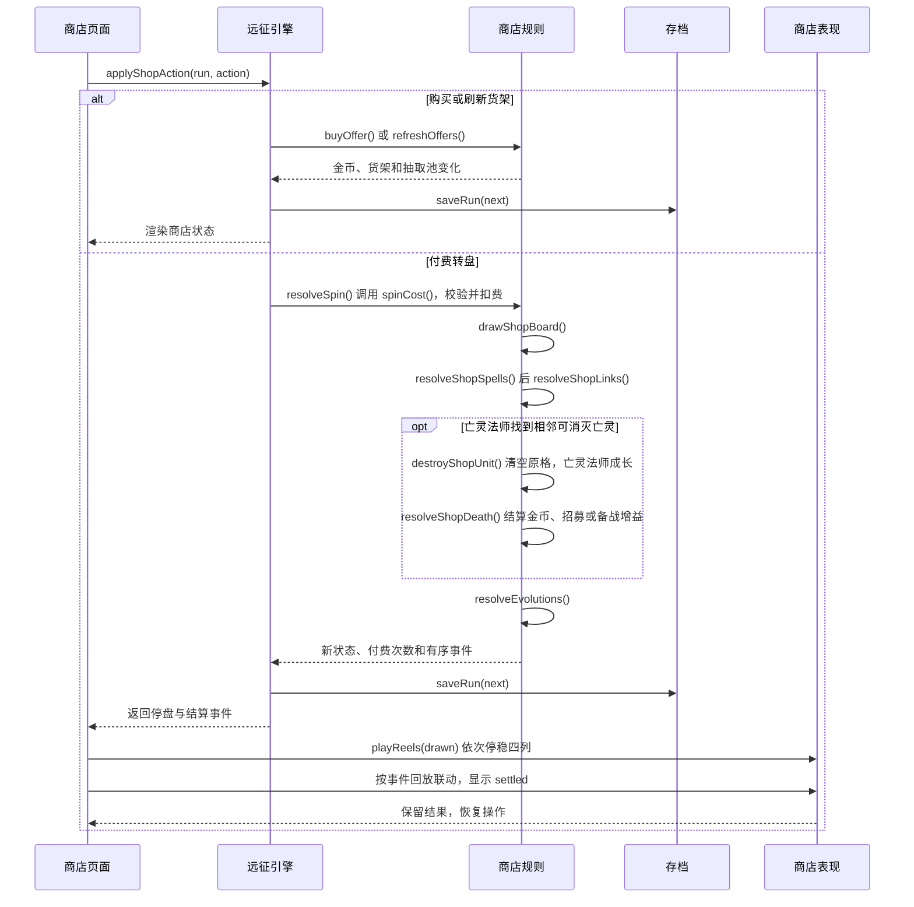
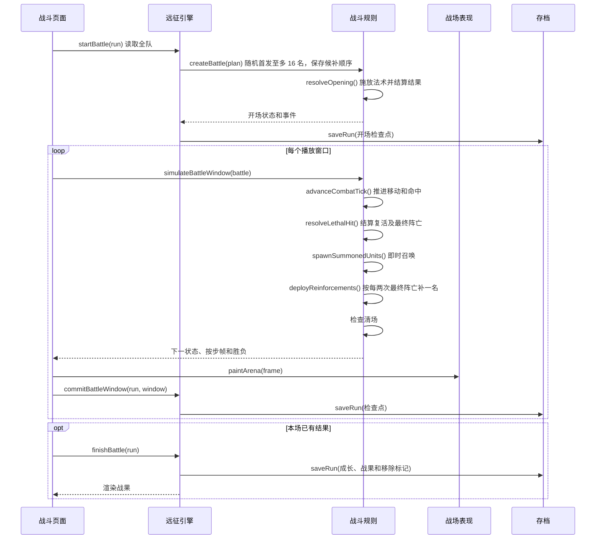

# ROLLBOUND 商店轮盘改造方案

**修订设计稿 · 2026 年 11 月 22 日**

开发基线为 GitHub 的 `stable-v2`，指向当前线上源码提交 `1a46fab`。[稳定版二](https://github.com/saiqi1999/ROLLBOUND/tree/stable-v2)

桌面商店以左侧的 **4×4 自有阵容轮盘**为视觉中心，右侧是货架。玩家用同一笔金币决定招募、转盘或刷新货架。四列依次停稳后回放联动。开战时从所有已招募且仍在队伍中的单位随机抽取首发，其余进入候补。战斗界面集中呈现走位、伤害、治疗、召唤和补员。[《背包乱斗》参考](https://store.steampowered.com/app/2427700/Backpack_Battles/)

## 1. 新的核心循环

| 阶段 | 玩家看到什么 | 玩家做什么 | 产生什么 |
| --- | --- | --- | --- |
| 进入商店 | 金币、下战敌阵、自有阵容、四张商品 | 预估下战需要输出、承伤还是成长 | 明确本店补强目标 |
| 招募与转盘 | 左侧盘面、当前摇盘费用和最近一次效果，右侧三张单位卡与一张法术 | 买棋子或法术改变抽取池，付费转盘触发联动 | 永久成长、进化、下一战准备效果和消灭收益 |
| 开战 | 队伍总人数、随机首发人数、候补数和准备效果 | 点击开战 | 从队伍抽取至多 16 名首发，保存候补顺序和效果快照 |
| 观看战斗 | 战场、剩余候补数、固定两行播报 | 观看，按需暂停、调速或快速结算 | 胜负、击杀成长、阵亡、召唤与补员 |
| 战后 | 战果、关键事件、获得的移除标记 | 看战报或进入下一间商店 | 永久成长随棋子保留，永久棋子恢复后继续留队 |

- 远征为七店七战。首店从空阵容开始，招募至少一名单位后才能开战。**每轮发放的金币翻倍**，七店依次发放 **20、8、10、12、14、16、18 金**，余款结转。落败或平局结束远征。第 2、4、6 战获胜各得一个移除标记。
- **商店定价**采用第 5 节的原价。刷新货架为 1 金，每间店的摇盘费用依次为 **1、1、2、2、3、3……**。买入的单位和法术从下一次转盘开始参与抽取。招募后可直接开战。
- **出战抽取**和商店盘面分别随机。队伍有 16 名或更少时全员首发，超过 16 名时随机首发 16 名，其余按随机顺序候补。每有两名已部署的招募单位最终阵亡，从候补补一名。
- **亡灵构筑**在商店消灭相邻亡灵来强化亡灵法师。骷髅兵给 2 金，重甲骷髅让三名骷髅兵加入队伍，骷髅弓箭手让消灭它的亡灵法师下战获得攻击增益。

队里只有一名其他兽人时，可以先招募第二名队友，再花金币把三名棋子摇到合适的位置。重甲兽人成功进化后，下一战抽到它时以骑兵身份入场，并通过连击体现进化结果。

### 1.1 金币发放与满编预测

| 战前商店 | 第 1 店 | 第 2 店 | 第 3 店 | 第 4 店 | 第 5 店 | 第 6 店 | 第 7 店 |
| --- | ---: | ---: | ---: | ---: | ---: | ---: | ---: |
| 当轮发放 | 20 | 8 | 10 | 12 | 14 | 16 | 18 |
| 累计发放 | 20 | 28 | 38 | 50 | 64 | 80 | 98 |

**16 名永久队员可填满首发，第 17 名才提供首个候补。** 轮盘还会抽到法术，所以盘面可能先填满。每有两名已部署的招募单位最终阵亡，补一名候补上场。

经济测算按每种策略 20,000 组种子进行，使用稳定版二的原价和随机货架。假设能依次进入七间店，先购物再摇盘，余款与当次消灭所得金币结转。计入亡灵法师招募自带的两名骷髅兵、被消灭产生的增减员与金币、蝙蝠赠送的法术和召唤法阵的永久招募。暂不使用移除标记，也不模拟战斗胜负。购买时优先选每名入队成员成本更低的卡。

| 花费方式 | 第 3、4、5、6 战开战前队员数中位数 | 首次满 16 人 | 首次有候补 |
| --- | --- | --- | --- |
| 优先扩军。金币用于买单位和 1 金刷新 | 14、18、23、28 | 第 4 战为中位数，约 92% 在此时已满过 | 第 4 战为中位数 |
| 每店摇两次，只购买单位，最多刷新一次 | 11、14、18、23 | 第 5 战为中位数，约 95% 在此时已满过 | 第 5 战为中位数 |
| 每店摇两次，买一张买得起的法术，最多刷新一次，其余买单位 | 9、12、15、20 | 第 5 战约一半，第 6 战约 96% 已满过 | 第 5 战约 33% 已有过候补，第 6 战约 90% |
| 每店摇两次，买一张买得起的法术，只看初始货架 | 9、12、15、18 | 第 6 战为中位数，约 83% 在此时已满过 | 第 6 战为中位数 |
| 每店摇四次，买一张买得起的法术，最多刷新一次，其余买单位 | 5、7、9、12 | 到第 7 战约 48% 满过 16 人 | 到第 7 战约 33% 已有过候补 |

按七战节奏，兼顾摇盘和法术的玩家通常在第 5～6 战填满首发。第 5 战的轮盘已可能填满，战场候补多在第 6 战才出现。如果希望候补在战役中段就能被体验到，试玩时可以用**第 5 战开战前有候补**作为观察目标，同时记录候补是否真的在该战入场。

## 2. UED 与页面状态

| 页面区域 | 界面内容 | 交互与反馈 |
| --- | --- | --- |
| 桌面商店左侧 | 4×4 轮盘占商店主体宽度约 55%–60%，下方是摇盘按钮与最近效果 | 四列沿竖向滚动并依次停稳，最后一列到位后才播放联动。每组联动同时突出来源和受益者，格子淡出并显示获得的金币、数值或棋子 |
| 桌面商店右侧 | 三张单位卡、一张法术卡、刷新货架、下战敌阵摘要 | 每张卡用自己的购买按钮。成功后卡片售罄，金币、抽取池和阵容同步更新 |
| 商店页底部 | 全队名单、移除标记、开战按钮 | 展示「20 名队员 · 随机首发 16 · 候补 4」及下一战准备效果，点击开战后揭晓首发 |
| 手机商店 | 顶部固定金币和下一战，中央单栏显示轮盘或货架 | 默认用整栏展示轮盘，页签切换货架。摇盘价格贴近主按钮，开战及首发摘要固定在底部 |
| 战斗 | 双方单位、血量和攻击数值、剩余候补数、控制按钮 | 守护、治疗、召唤和连击用场上动作及飘字表达。补员从己侧入场并更新候补数。固定两行播报写清「候补入场」或「骷髅召唤」 |
| 战果 | 胜负、永久成长、本场阵亡、移除标记 | 点回看按逻辑步播放。获胜后进入下一店，败局或平局进入本局总结 |

### 2.1 一次转盘的表现

| 阶段 | 首测时长 | 表现 |
| --- | --- | --- |
| 操作前 | 玩家决定 | 按钮显示「摇盘 · 1 金」等当次费用，并提示下一次费用。可抽数量、余款不足和抽取池为空的提示靠近按钮 |
| 起转 | 约 0.10 秒 | 四列同时向下加速，图标在各自的裁切窗口内滚动，面板保持固定 |
| 滚动与停盘 | 点击后的第 0.60、0.71、0.82、0.93 秒分别停一列 | 从左到右减速并对齐格线。每列到位时可播放短停轴声。完全停稳时，四列都对齐到已抽出的图标和空格 |
| 联动回放 | 全部停稳后 | 按规则事件顺序依次突出每组联动，同一组来源与受益者在原位一起轻动。亡灵消灭可显示「骷髅兵消失 · 亡灵法师永久 +2/+2 · 金币 +2」 |
| 结果保留 | 至下一次付费转盘 | 无联动时显示「本次未触发联动」。保留最终盘面和效果摘要供回看，主按钮恢复操作并更新价格 |

动效节奏参考《幸运房东》的实机展示。转动到停稳约 **0.93 秒**是 ROLLBOUND 的首测参数，四列停盘间隔可以单独调节。[《幸运房东》官方演示](https://trampolinetales.com/lbal/presskit#videos)

商店在「可操作 → 滚动 → 联动回放 → 结果保留」之间流转。滚动与联动回放期间暂锁购买、刷新、移除和开战。跳过动效或使用减少动态效果设置时，直接显示同一盘结果及其摘要。准备效果留在队伍详情，战斗专注场上行动。

## 3. 结算规则

### 3.1 商店盘

- **费用**由本店已完成的付费转盘次数决定。第 `k` 次摇盘花 `1 + floor((k - 1) / 2)` 金，从 1 开始计数。进入新店时重新计数，购买、刷新货架、移除和被拒绝的操作都不计次。确认余款足够后先扣当次费用，盘中的加金币效果随后入账。
- **抽样**从当前队伍和未用法术中等概率无放回抽取最多 16 个实例，随机落位。数量不足时补空格。同名棋子依照实例 ID 各占一格。
- **相邻**指共享边或角的格子，最多八个邻格。商店棋子以落格位置作为邻接条件。进战后单位按战场坐标行动。
- **顺序**依次为一次性法术、棋子联动、进化检查。法术和棋子各自在本段内从左到右、从上到下结算。几何落位固定，后续效果读取当前格子内容。被消耗的格子当次变空，新招募的单位在下次转盘才可出现。
- **永久成长**写入单位实例。见习弓手每店最多通过自身能力成长一次。**下一战数值增益**按「效果名＋目标实例」记一份并取最高档，不同效果名可叠加。医师的治疗按来源存一份，每次成功联动会更新其目标。
- **进化**按准备完的攻击力和本盘联动判定，同一枚棋子每次操作最多前进一阶。进化保留实例 ID 和已有成长。移除史莱姆等商店操作增加攻击后，同样检查普通兽人的进化。

### 3.2 商店消灭与死亡效果

每枚亡灵法师每次付费转盘可依格序消灭至多两名相邻的友方骷髅兵、重甲骷髅或骷髅弓箭手。每次消灭先将目标从本盘及队伍移除，清除其成长与准备效果，亡灵法师永久获得 **+2 攻击、+2 生命**，再结算目标的商店死亡效果及同盘友方响应。亡灵法师消灭不消耗移除标记。

| 被消灭的棋子 | 商店死亡效果 |
| --- | --- |
| 骷髅兵 | 获得 **2 金** |
| 重甲骷髅 | 将 **3 名基础骷髅兵**永久加入队伍，各用新实例 ID。可参加紧接着的战斗，从下一次付费转盘开始参与抽取 |
| 骷髅弓箭手 | **首测效果**，使消灭它的亡灵法师在下一战获得 **+3 攻击** |

当同盘其他友方亡灵被消灭时，仍在盘上的骷髅弓箭手获得下一战 +3 攻击。骷髅弓箭手提供的同名准备增益对同一目标取最高档。刚生成的棋子等下次才可能进盘，原格本次保持为空。后续效果读取当前盘面。

### 3.3 开战、阵亡和结算

1. **开场抽取。** 快照包含全队现存的永久招募单位、各自的成长与准备效果，以及装填好的法术。按实例随机打乱一次，首发前 16 个，余额按该随机顺序候补。敌方从其关卡配置出发，同样使用这条部署规则。两边首发到位后按装填顺序施放开场法术。
2. **战场步进。** 每个逻辑步为 145 毫秒。出手优先锁定有守护的目标，命中先扣护甲再扣生命，最终阵亡的单位立即离开目标池。成功复活的圣殿骑士继续使用原部署名额。
3. **阵亡补员。** 各方独立累计已部署的招募单位最终阵亡次数，首发和后来上场的候补都计入。每满两次扣除两次计数，有候补就抽一名入场，未凑成对的阵亡留待下一步。若有 20 名队员，开场 16 人、候补 4 人，两名首发阵亡后为 **15 在场、候补 3**。补员入场时取自己的准备效果。
4. **即时召唤。** 重甲骷髅最终阵亡时立即召唤 3 名临时骷髅兵。所有战斗内召唤都可直接入场，实际同时存活人数可以超过 16。临时召唤的单位阵亡照常触发亡灵等战斗效果，候补计数只取自已部署的招募单位。
5. **清场判断。** 当前逻辑步完成命中、复活、最终阵亡、死亡效果、即时召唤和符合条件的候补后，再按双方场上存活数判定。单方清空则落败，双方清空或 1,000 步后双方仍有单位则为平局。开场法术逐个应用同一套阵亡、召唤和补员规则，全部处理后判断清场。

战斗结束时，将骑兵等产生的永久成长按实例回写。首发、候补和阵亡的永久单位都留在队伍，下战恢复生命。本场准备效果统一失效，战斗尸体和临时召唤清理完毕。战果、移除标记和下一关金币在各自结算节点各提交一次。

## 4. 工程骨架

### 4.1 当前实现与迁移落点

| 当前位置 | 稳定版二的职责 | 计划落点 |
| --- | --- | --- |
| `web/src/engine.ts` | 管远征状态，`step()` 先摇双方轮盘，再召唤、施法、联动和推进最多 10 个战斗步，`commitRoll()` 提交 | 保留远征入口。商店动作与战斗步进各有独立入口 |
| `web/src/battle/wheel.ts` | 3×3 双方抽取、邻接几何、战斗上限 | 盘面抽取和邻接迁到 `shop/wheel.ts`。战斗模型管理首发与候补 |
| `web/src/battle/combat.ts`、`unit-state.ts` | 路径、站位、目标、前后摇、技能队列、连续攻击 | 移动、选敌、前后摇和连击沿用。盘面技能调用移到商店，战斗加入开场法术与本地反应 |
| `web/src/battle/effects.ts` | 处理入场、盘面联动、法术及命中阵亡 | 商店负责相邻联动、消灭、死亡收益和进化。战斗负责命中、治疗、复活、阵亡、即时召唤与候补补员 |
| `web/src/main.ts`、`playback.ts`、`arena.ts` | 页面、存档、双轮盘和战场的同步播放 | 商店视图播放单轮盘结算。战斗视图消费单独的战斗帧 |

### 4.2 文件与核心入口

以下相对路径基于 `web/src/`。表中新增和迁移后的接口用于工程评审。

| 文件 | 职责与入口 |
| --- | --- |
| `data.ts` | 维护单位、法术、原价、敌阵、每轮发放的金币和阈值。技能文案读同一份配置 |
| `engine.ts` | `newRun(seed)`、`applyShopAction(run, action)`、`startBattle(run)`、`commitBattleWindow(run, window)`、`finishBattle(run)`、`advance(run)` |
| `shop/model.ts` | `ShopState` 记录金币、`paidSpins`、货架和停盘。定义 `ShopSlot`、`ShopAction`、`ShopEvent` 和准备效果 |
| `shop/wheel.ts` | `drawShopBoard(pool, rng)`、`neighborSlots(board, index)`。屏幕行列由配置提供 |
| `shop/rules.ts` | `spinCost(paidSpins)`、`resolveSpin(shop, roster)`、`resolveShopSpells()`、`resolveShopLinks()`、`destroyShopUnit()`、`resolveShopDeath()`、`resolveEvolutions()`。一次提交费用、次数、结果和事件 |
| `battle/model.ts` | `BattlePlan`、`BattleState`、`BattleEvent`，声明首发、候补、未折算为补员的阵亡数、单位来源和逻辑时间 |
| `battle/combat.ts`、`battle/effects.ts` | `createBattle(plan)`、`resolveOpening()`、`simulateBattleWindow()`、`advanceCombatTick()`、`resolveLethalHit()`、`spawnSummonedUnits()`、`deployReinforcements()` |
| `view/shop.ts`、`view/reels.ts` | `renderShop()`、`playShopSpin(result)`、`playReels(drawn)`。四列的演出按配置时序落在传入的格子上，再按事件回放 |
| `view/battle.ts`、`arena.ts` | `renderBattle()`、`paintArena()`。读取首发、候补和即时召唤的入场事件，渲染其出生位置。出生位置由规则层安排，拥挤时复用移动避让 |
| `main.ts`、`save.ts` | 路由、命令分发、播放控制、`loadRun()`、`saveRun()` 和刷新恢复 |

### 4.3 数据边界和保存

```ts
type UnitInstance = { id: string; kind: Kind; gainedAttack: number; gainedHealth: number };
type ShopSlot =
  | { type: 'unit'; id: string }
  | { type: 'spell'; id: string }
  | null;

type ShopSpinResult = { drawn: ShopSlot[]; settled: ShopSlot[]; events: ShopEvent[] };
type BattlePlan = {
  allyRoster: BattleUnitSpec[];
  enemyRoster: BattleUnitSpec[];
  preparations: PreparedEffect[];
  seed: number;
};
type BattleSide = {
  reserve: BattleUnitSpec[];
  recruitedDeathsTowardReinforcement: number;
};
type BattleUnitOrigin = 'recruited' | 'summoned';
```

- 随机出战、候补、成长和治疗目标都绑定稳定实例 ID。商店消灭时解除原单位的引用，死亡效果生成的新单位采用递增实例编号。进化延续原 ID。
- 商店消灭和战斗阵亡各有结算入口。表里定义的商店死亡效果从 `resolveShopDeath()` 派发。战斗里由 `resolveLethalHit()` 处理同一棋种在该阶段的效果。
- 为货架、商店抽取、随机出战、战斗选敌和随机效果分别记录随机状态。上场顺序、候补余量和阵亡计数纳入检查点。滚动画面使用独立的展示图标序列，随后对齐 `drawn`，联动播放结束后展示 `settled`。
- 新设计使用独立存档键 `rollbound.shop-wheel.v4`。旧远征可在 `stable-v2` 读取。战场使用开战快照与新的战斗检查点，完整输入可重算回放。
- 商店转盘在同一次提交中更新金币、付费次数、成长、进化、停盘和事件记录，提交后才播动画。刷新页面时恢复已提交的费用和结果。战斗每个播放窗口提交一次检查点。结果提交校验本场 ID 和阶段，重复调用只读取已结算战果。

### 4.4 方法调用时序

#### 商店购买与付费转盘



`applyShopAction()` 先验证商店阶段、货架售罄、金币和操作对象。一次性法术转出的随机结果和触发细节都在 `resolveSpin()` 内决定。页面根据事件显示变化。

#### 随机出战、步进与战果



开场法术与战斗命中共用阵亡结算。动作、即时召唤和候补入场以独立事件保存。快速结算循环同一个 `simulateBattleWindow()`，通过同样的接口提交结果。

## 5. 已有棋子的数值与效果修改

下表覆盖稳定版二的全部 **18 种棋子**。基础栏按 **售价 / 攻击 / 生命** 排列，商品采用稳定版二的价格。下场数值在商店显示为「备战」，战斗中生效的成长按本场或永久标注。[基线单位数据](https://github.com/saiqi1999/ROLLBOUND/blob/stable-v2/web/src/data.ts)

| 种族 | 棋子 | 基础数值 | 稳定版二效果 | 商店轮盘版效果 |
| --- | --- | --- | --- | --- |
| 人类 | 木盾卫士 | 2 / 2 / 12 | 攻击时自身获得 2 护盾 | **战斗**，每次攻击获得 2 护盾。为相邻见习弓手提供联动条件 |
| 人类 | 见习弓手 | 3 / 3 / 7 | 摇到且邻接木盾卫士，永久 +1 攻击 | **商店**，相邻至少一名木盾卫士时永久 +1 攻击，每店每枚一次 |
| 人类 | 战地医师 | 3 / 1 / 8 | 为一个相邻受伤友方恢复至多 12 生命 | **商店**，随机选一个相邻友方作为下场治疗对象。**战斗**，两者在场存活时，目标受伤且生命降到半血及以下就恢复至多 12 生命，每名医师本场一次 |
| 人类 | 士兵 | 2 / 2 / 6 | 入场使所有在场人类 +1 生命 | **商店**，使同盘的其他友方人类下场 +1 生命 |
| 人类 | 剑士 | 3 / 2 / 6 | 入场使相邻在场人类本场 +2/+2 | **商店**，使相邻友方人类下场 +2/+2 |
| 人类 | 重甲斧 | 3 / 2 / 10 | 守护。入场和阵亡使己方在场人类获得 3 护甲 | **商店**，相邻友方人类下场带 3 初始护甲。**战斗**，守护。最终阵亡时友方在场人类获得 3 护甲 |
| 人类 | 长枪兵 | 3 / 2 / 6 | 摇到且有相邻空位，本场 +2/+1 | **商店**，有相邻空位时下场 +2/+1 |
| 人类 | 圣殿骑士 | 4 / 2 / 9 | 守护。首次阵亡满血复活并为友方在场人类本场 +1/+1 | **战斗**，守护。首次倒下满血复活，复活时使友方在场人类本场 +1/+1 |
| 人类 | 法师 | 3 / 2 / 7 | 入场使相邻在场友方 +1/+1，本局每施放一法术增幅 +1/+1 | **商店**，相邻友方下场获得 +1/+1。本局每结算一个法术使增幅 +1/+1，首测上限 +4/+4 |
| 兽人 | 兽人 | 3 / 3 / 10 | 当前攻击力超过 5 时永久进化 | **商店**，备战攻击力达到 6 时永久进化为重甲兽人。备战攻击含永久攻击与已登记的下一战攻击加成 |
| 兽人 | 重甲兽人 | 5 / 3 / 24 | 守护。与至少 3 个其他兽人相邻时永久进化 | **商店**，与至少 **2 名其他友方兽人**相邻时永久进化为兽人骑兵。**战斗**，重甲形态具有守护 |
| 兽人 | 兽人骑兵 | 6 / 3 / 24 | 额外连击一次，击杀永久 +1/+1 | **战斗**，普攻额外连击一次。第一击造成最终阵亡时，追加攻击寻找射程内的有效目标。每次最终击杀永久 +1/+1 |
| 亡灵 | 亡灵法师 | 5 / 3 / 12 | 购买附带 2 骷髅兵。消耗所有相邻尸体，每具永久 +2/+2 | **招募**，附带 2 个骷髅兵。**商店**，消灭至多 2 名相邻的骷髅兵、重甲骷髅或骷髅弓箭手。每消灭一名，永久 +2/+2 |
| 亡灵 | 骷髅兵 | 1 / 1 / 3 | 阵亡额外留下 1 具尸体 | **商店**，被消灭时获得 2 金 |
| 亡灵 | 骷髅弓箭手 | 2 / 2 / 7 | 友方亡灵阵亡时，在场的它本场 +3 攻击 | **商店**，同盘其他友方亡灵被消灭时，自身下场 +3 攻击。被消灭时，使消灭它的亡灵法师下场 +3 攻击。**战斗**，每有一名友方亡灵最终阵亡，在场的它本场 +3 攻击 |
| 亡灵 | 重甲骷髅 | 4 / 2 / 12 | 守护。阵亡招来 3 个临时骷髅兵 | **商店**，被消灭时永久招募 3 名基础骷髅兵。**战斗**，守护。最终阵亡时立即召唤 3 名临时骷髅兵 |
| 怪物 | 史莱姆 | 1 / 1 / 6 | 用标记移除时，队伍中其余单位永久 +2/+2 | **商店移除**，消耗一个标记移除后，所有其余永久单位立即永久 +2/+2 |
| 怪物 | 蝙蝠 | 3 / 2 / 5 | 购买时随机获得一张法术 | **招募**，从现有法术池随机获得一张，放入下次转盘抽取池 |

4×4 里，当重甲兽人和恰好三名其他兽人同盘且均匀落格时，同时邻接三名的概率约为 **4.2%**。首测把门槛改为邻接其中至少两名，在同样条件下约为 **28.0%**。这是盘面几何的对照，实际触发率还受阵容和抽取上限影响。

### 5.1 法术如何进入新循环

| 法术 | 金币 | 商店停盘后的处理 |
| --- | ---: | --- |
| 魔力强化 | 3 | 相邻单位永久 +2/+2，当场进入成长和进化检查 |
| 火球术 | 4 | 装填到下一战，开场随机消灭一名在场敌人，正常结算阵亡与复活 |
| 召唤法阵 | 2 | 随机招募一名永久人类并使其永久 +3/+3，新单位从下一次付费转盘参加抽取 |

法术摇出后消耗。每次结算记入本局施法计数，火球术以装填时计数。未摇出的法术随远征继续携带。治疗和火球的播放事件记录实际来源和目标，方便战报追溯本场效果。

## 6. 实现顺序与验收

1. **先打通一店一战。** 以兽人进化链和人类准备增益验证买、摇、出战、战后返回的完整路径，确认手机切页和扣费反馈。
2. **再迁移剩余棋子与法术。** 接入逐列停盘、三个商店死亡效果、随机首发和两次阵亡补员，核对完整的 18 种棋子和三张法术都由规则层执行。
3. **最后跑七战和移动端试玩。** 沿用稳定版二的起始种子和关卡作为对照。在新经济下比较偏招募、偏转盘、兼顾移除的花费方式。统计每店购买数、转盘次数、有效联动率、首次满盘与满编、首次有候补与首次补员入场，以及通关率和失败关卡。稳定版二的 5,000 局随机基准为保留阵容 **29.7%**，优先移除史莱姆 **40.7%**。[稳定版二模拟记录](https://github.com/saiqi1999/ROLLBOUND/tree/stable-v2/docs)

| 验收点 | 通过标准 |
| --- | --- |
| 轮盘与战场的焦点 | 在手机和桌面上，玩家能在自己的节奏里读完一次联动，并在战斗中指出至少一项可见的行动变化 |
| 花费有取舍 | 七店分别发放 20、8、10、12、14、16、18 金，单位和法术按原价售卖。连续摇六次扣 1、1、2、2、3、3 金。刷新货架后沿用当店档位，换店后从 1 金起。模拟记录各店招募、转盘、消灭收入和触发率 |
| 四列停盘 | 四列同起、依次停稳，四列到位后开始联动。双击、刷新、跳过和倍速下，同一指令得到相同停盘、目标和胜负，每次操作恰好扣款与结算一次 |
| 三种亡灵消灭 | 同盘两名亡灵法师共享目标时仅消灭一次。骷髅兵只产出 2 金。重甲骷髅产生带新 ID 的 3 名骷髅兵。骷髅弓箭手的 +3 攻击绑定到实际消灭者 |
| 随机首发与补员 | 20 名不同实例随机首发 16、候补 4。两名已部署招募单位最终阵亡且无额外召唤时，补一名后为 15 在场、候补 3。首发和候补各自的准备效果随着入场生效 |
| 即时召唤与清场 | 16 名首发中重甲骷髅阵亡，3 名临时兵立即入场，在场变 18，补员计数为 1。临时兵阵亡及圣殿骑士成功复活不推进该计数。当步的召唤和补员先于清场判断 |
| 可以回滚 | `stable-v2` 仍能检出完整的网页源码、测试和美术构建入口，新存档可以独立启动 |
