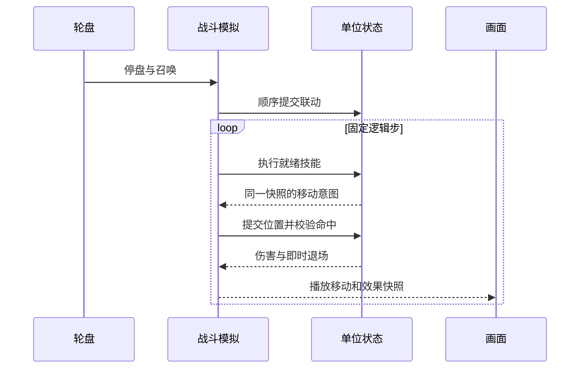

# ROLLBOUND 战斗迁移审计

「稳定版本一」对应 GitHub 的 [stable-v1 分支](https://github.com/saiqi1999/ROLLBOUND/tree/stable-v1)，固定在 `45897cf7abbbc4a901ed5fe8037bffa984b8fb36`。新版使用 `rollbound.trial.v2`，首次访问开新档。需要回滚时，在 GitHub Actions 的 **Build and deploy ROLLBOUND** 手动选择 `stable-v1` 运行即可恢复旧页面。也可在 `main` 上撤销新版提交，让同一工作流重新发布。旧页面从 `rollbound.trial.v1` 读取旧进度。

## 迁移前的硬编码和一致性风险

按问题归并，共 **10 类**。定位列的行号对应稳定版本一。

| 类型 | 定位 | 迁移处理 |
| --- | --- | --- |
| 轮盘尺寸 | `engine.ts:100,119,166–167`，`style.css` 的轮盘网格 | 盘面生成、抽取数量、斜角相邻和 CSS 网格列数共用 `WHEEL_WIDTH`。出战上限独立定义 |
| 普攻入口和行动先后 | `engine.ts:163–186,347–364` | 轮盘负责召唤、施法和提交联动。所有已在场单位按固定步行动。同一步命中按双方交替优先、队内实例序号结算 |
| 双方移动的读写顺序 | `arena.ts:37–50` | 双方以同一份位置快照计算移动意图，碰撞处理考虑相对位移，统一提交位置后再判射程和命中 |
| 相邻条件、触发与执行 | `engine.ts:145–153,245–298` | 每条联动携带原始摇次和候选 ID，按己敌盘序和格序进入队列，执行时复核在场、受伤和尸体占位。延迟到下一摇的技能在战场显示结果和原摇次 |
| 临时属性的边界 | `engine.ts:23,287,364` | 骨弓手将 +2 留到下一次有效普攻命中，重复触发刷新同一份加成。永久属性和本场属性继续分别结算 |
| 守护和即时退场 | `engine.ts:300–364` | 选敌锁定存活目标，进入射程才出手，命中时复核存活与距离。阵亡立即取消待发动作并离场。圣殿骑士首次复活后从下一步重新行动 |
| 随机状态耦合 | `engine.ts:166–167,220,229,294,303` | 分离轮盘、单位选敌和技能效果的随机状态。场上变化仍可通过尸体、召唤和消耗影响下次实际抽取 |
| 场景重建与动画时钟 | `arena.ts:37–58`，`main.ts:184–195` | Phaser 按单位 ID 保留位置、精灵和属性显示。暂停冻结动画和播放计时，倍速仅影响演出。移动事件只更新画面，战报记录技能及伤害 |
| 旧分支和重播状态 | `engine.ts:121–140,245–364`，`main.ts:10–44,275–276` | 删除英雄血量、旧攻击顺序、旧成长开关与存档迁移。正常播放、单步、快速结算、模拟和新档回看共用 `step()` |
| 关卡固定增益依赖旧攻速 | `data.ts` 的七关数值，`scripts/simulate-difficulty.mjs` | 按固定步、攻击恢复和新攻防节奏重新模拟，调整六关的敌方统一生命或攻击修正。七关阵容继续由数据表定制 |

## 代码入口

| 文件 | 责任 |
| --- | --- |
| `web/src/engine.ts` | 远征、每摇流程、战斗快照与结算 |
| `web/src/battle/wheel.ts` | 九宫格、抽签、斜角邻居、出战上限 |
| `web/src/battle/model.ts` | 逻辑步与近战、远程属性和单位状态 |
| `web/src/battle/combat.ts` | 逐步推进技能队列、移动、起手与命中 |
| `web/src/battle/movement.ts` | 从全场快照规划局部绕行并处理移动接触 |
| `web/src/battle/unit-state.ts` | 单位选敌、射程、数值和恢复状态 |
| `web/src/battle/effects.ts` | 入场、法术、相邻技能、命中、死亡与复活 |
| `web/src/main.ts`、`arena.ts`、`timing.ts` | 播放、移动插值、受击闪白和轮盘动效 |

每摇最多推进 10 步，1× 速度下约为 1.45 秒。历史战斗回看按存档记录的步数播放。近战射程为 112，长枪兵为 154，远程为 374，场地宽度为 1000 逻辑单位。第二摇开始，每步完成后检查清场，第 100 摇结束仍未分胜负时判平。当前战场采用局部避让，双方各九人同时挤向同一目标时，外围单位可能多花几步绕行。前摇、恢复步数和走位速度集中在 `model.ts`，便于继续调优。

## 验证

运行 `npm test` 与 `npm run build`。回归测试覆盖双向移动的碰撞、未抽中单位普攻、跨摇联动、死亡取消攻击、守护、即时复活、存档重载、播放与无表现模拟的一致性。

### 难度对照

旧版和战斗迁移初版各用 2,000 个相同起始种子。迁移初版首摇推进 3 步，后续每摇最多推进 6 步。策略每家店在付得起的单位中随机招募一枚，跳过测试只跳过该关商店。模拟会延续已经失败的样本来测后续单关，七战通关率只计算全胜。测试未购买法术、刷新商店或使用移除标记。

| 关卡 | 稳定版本一 · 招募一枚 | 新版 · 招募一枚 | 新版 · 跳过本店 |
| --- | ---: | ---: | ---: |
| 1 边境巡队 | 100.0% | 97.9% | 79.0% |
| 2 灰骨哨所 | 95.7% | 88.5% | 45.4% |
| 3 裂牙先锋 | 80.5% | 79.3% | 43.2% |
| 4 黑铁前线 | 60.4% | 60.0% | 37.0% |
| 5 荒原围军 | 51.6% | 61.4% | 37.9% |
| 6 铁誓军团 | 51.8% | 42.7% | 29.4% |
| 7 暮色王庭 | 41.5% | 48.3% | 37.6% |
| 七战全胜 | 24.0% | 22.9% | — |

在战斗迁移初版提交 `d600357` 上，复现命令为 `cd web && node scripts/simulate-difficulty.mjs 2000 100000`。在这组样本里，全程跳过招募的两版通关率均为 0%。
