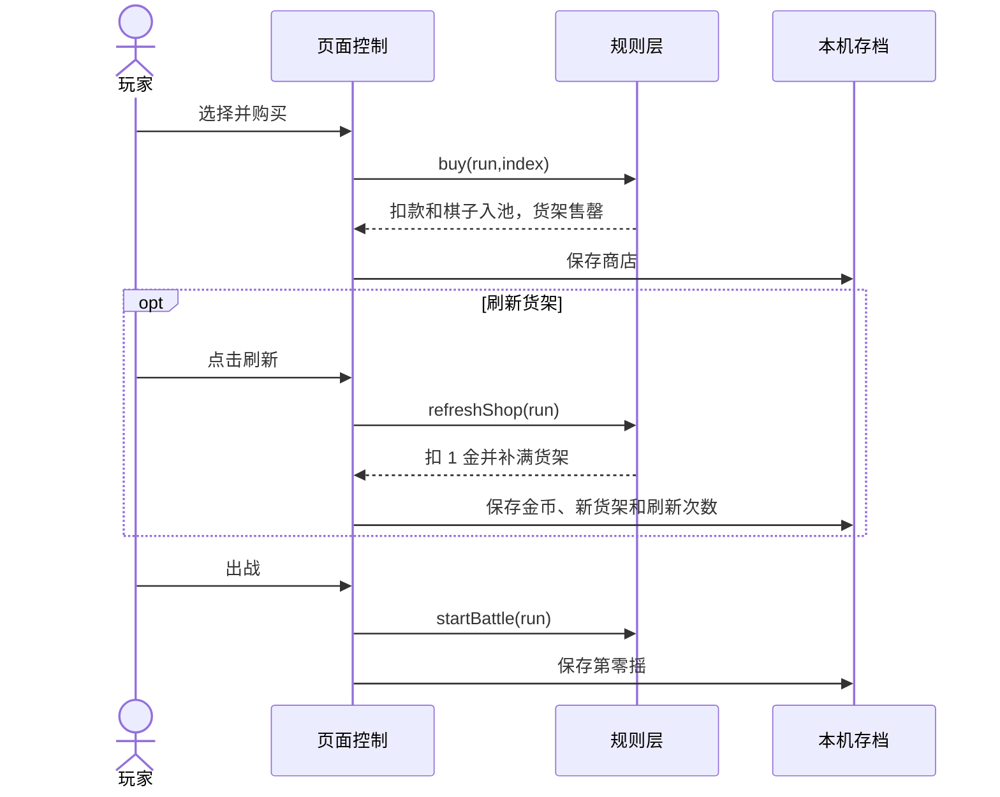
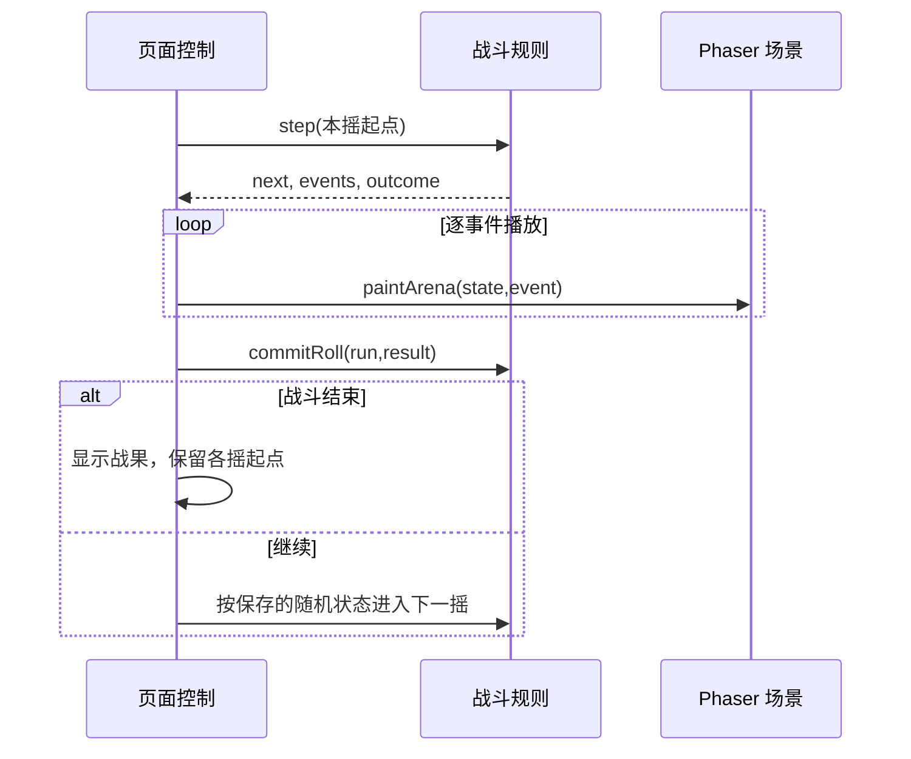

# ROLLBOUND 网页原型设计方案

每局最多经过七间商店和七场战斗。试玩者打开网页即进第一间商店。七战全胜即通关，落败或平局后立即结算本局。

## 第一章　UED 与玩法

### 页面与状态

| 页面 | 内容 | 操作与流转 |
| --- | --- | --- |
| 商店 1～7 | 金币、同排的三个单位货架和一个法术货架、招募预览、现有队伍、下战敌人及其基础属性 | 单位逐枚招募。花 1 金重新抽取三种不同单位和一个法术。从移除标记入口进入独立的阵容管理页。备战完成后进入当场战斗 |
| 移除棋子 | 标记余额、按实例列出的阵容、每枚棋子的攻击和生命 | 选中棋子后确认，消耗 1 个标记并将它从本局阵容移除。可以返回商店 |
| 战斗 | 双方 3×3 轮盘、共享战场、双方在场单位数、摇号、当前事件 | 默认自动推进；暂停、单步、1/2/4 倍速、战报和快速结算 |
| 战果 | 在场单位数、胜负、本场摇数和阵亡数 | 逐摇回看。获胜后可进入下一店并获得 3 金。第 2、4、6 战胜利时各获得 1 个移除标记 |
| 总结 | 已进行场次的胜负、最终阵容和总胜场 | 再来一局，重新生成种子 |

开局有 5 金、两个木盾卫士和一个士兵。首店、后续商店和付费刷新均随机推出三个单枚单位与一个法术，四张商品使用相同的卡片布局。法术池包含召唤法阵（2 金）、魔力强化（3 金）和火球术（4 金）。商店间保留金币、未使用的移除标记和未摇出的法术。新一战开始时所有棋子恢复至满血，护盾清空。永久的攻击、生命成长跟随各自的棋子，保留至本局结束。

七关敌阵人数从 3 人逐关增加到 9 人。用不同的种族联动、守护和敌方基础属性提高难度。每方最多有九个在场单位。之前已召唤但本摇未点亮的单位仍占用出战位。

### 轮盘与战斗

每个实例属于一名玩家、占一个格。每摇从存活棋子、尚未被消耗的尸体与待施放法术中等概率无放回抽取最多9枚，随机排入九宫格，所有上盘棋子各点亮一次。未占格为界面底板。待出战棋子点亮时尝试召唤，在场棋子点亮时普攻一次，尸体占格并等待被消耗。一枚单位在同摇最多出现一次。未上盘的已召唤单位留场，可被选为攻击目标。

1. 停盘并显示双方当前格子。
2. 按各自轮盘的格序召唤至九个出战位满。全部入场完成后，按格序处理入场能力，同一摇刚登场的队友可以获得这些加成。成功上场的单位可参与联动，从下一次摇到它时开始攻击。召唤失败的棋子左右轻晃，本摇跳过，后续摇盘可再次尝试。
3. 召唤完成后，从左到右、从上到下施放轮盘上的法术。即使没有合格目标，摇出的法术仍永久消耗，并计入本局施法次数。法师的入场增益持续本场战斗，入场时只读取已经施放的法术。召唤法阵招募的单位从下一摇起进入轮盘池，按正常出战位规则登场。
4. 按本轮盘面计算相邻。共边和共角都算，本格不算。医师随机治疗一个相邻、在场、存活的受伤单位。暮王按格序消耗相邻尸体，每具使攻击力、当前生命和生命上限各增加2。
5. 按轮盘顺序逐次结算普攻。每次出手时，有存活的守护敌人在场时，从守护敌人中等概率选一个目标。否则从全部存活在场敌人中等概率选一个目标。护甲与原有护盾使用同一数值，优先抵消伤害。木盾卫士执行普攻时获得2点护盾。无有效目标时跳过该次攻击。
6. 致死一击后立即结算阵亡并播放退场。阵亡者退场，跳过本摇尚未执行的攻击，死亡帧留在轮盘池中。圣殿骑士的首次阵亡会立即复活，继续参与守护。永久退场的重甲斧在下次攻击选目标之前为队友叠加护甲。后续攻击重新使用当前存活单位和守护状态选目标。
7. 第2摇起，每摇阵亡结算完毕后，场上没有存活单位的一方落败。若双方同时全灭，或打满100摇仍各有在场单位，则记平局。平局计零胜。

种族包含人类、兽人、亡灵、怪物。人类群体效果只作用于友方存活在场的人类，符合条件的来源自身也获得加成。新单位的属性成长只持续本场战斗。生命值加成同时增加当前生命和生命上限。尸体和满员未召唤的棋子都占用轮盘格。长枪兵按联动结算时的盘面判断相邻空位，同一摇只触发一次。

| 单位 | 种族 | 生命 | 攻击 | 特效 |
| --- | --- | ---: | ---: | --- |
| 木盾卫士 | 人类 | 12 | 2 | 攻击时，自身获得2点护盾。 |
| 见习弓手 | 人类 | 7 | 3 | 每次摇到时，若与木盾卫士相邻，永久获得+1攻击力。 |
| 战地医师 | 人类 | 8 | 1 | 为一个随机受伤的相邻友方单位恢复3点生命值。 |
| 暮王 | 亡灵 | 12 | 3 | 消耗所有相邻尸体。每消耗一具，永久获得+2攻击力和+2生命值。 |
| 纸甲侍从 | 亡灵 | 3 | 1 | 普通攻击。 |
| 兽人 | 兽人 | 10 | 3 | 普通攻击。 |
| 骨弓手 | 亡灵 | 7 | 2 | 与兽人相邻时，本轮攻击力+2。 |
| 士兵 | 人类 | 6 | 2 | 入场时，使所有友方在场人类获得+1生命值。 |
| 剑士 | 人类 | 6 | 2 | 入场时，使相邻的友方在场人类获得+2/+2。 |
| 重甲斧 | 人类 | 10 | 2 | 守护。入场和阵亡时，使所有友方在场人类获得3点护甲。 |
| 长枪兵 | 人类 | 6 | 2 | 每次摇到时，若相邻格有空位，获得+2/+1。 |
| 圣殿骑士 | 人类 | 9 | 2 | 守护。每场战斗首次阵亡时，满血复活并使所有友方在场人类获得+1/+1。 |
| 法师 | 人类 | 7 | 2 | 入场时，使相邻的在场友方单位获得+1/+1。本局每施放一个法术，此加成提高+1/+1。 |

| 法术 | 价格 | 效果 |
| --- | ---: | --- |
| 魔力强化 | 3 金 | 使相邻的在场友方单位永久获得 +2 攻击和 +2 生命。生命加成同时提高当前生命和上限。 |
| 火球术 | 4 金 | 等概率消灭一个在场敌人，忽略守护与护甲。触发正常的阵亡和复活流程。 |
| 召唤法阵 | 2 金 | 等概率从人类单位中招募一枚新的棋子。它永久获得 +3 攻击和 +3 生命，可与现有棋子重名。 |

### 视线与移动端

桌面战场居中，己方与敌方轮盘分置两侧。手机把两个轮盘并排放在战场上方。滚盘、召唤、法术、联动、攻击、死亡分拍播放；联动阶段与普攻阶段分别先读己方盘、再读敌方盘，每个盘从左到右逐行向下结算。每次联动将发起者与所有参与的相邻棋子放在同一拍，图标保持朝向，同步沿半径 3 像素的圆移动一周，1× 下用时 360 毫秒。暮王和命中的尸体一起绕圈，联动结束后尸体从盘面和抽取池移除。召唤失败时轮盘棋子左右轻晃 240 毫秒，与联动使用相同的动效入口。战场描出联系线，只有实际受益者显示数值。普攻在 1× 下每击 160 毫秒，由战场动作和命中闪白表现；轮盘保持静止。死亡播放倒下动作。单步可读相同一摇中敌我双方的配合。

商店在手机竖屏使用横向卡片和置底出战按钮。可以点击阵容头像查看卡文、点击战场角色查看当前属性。关闭详情回到之前的播放状态。浏览器切至后台时自动暂停。减少动态效果偏好下角色使用静态帧。

## 第二章　工程技术

### 目录与职责

| 路径 | 主要职责 |
| --- | --- |
| web/src/data.ts | 棋子、售价、套组、七关敌阵与属性加成 |
| web/src/engine.ts | 数据结构、确定性随机数、商店、轮盘、战斗、局内推进 |
| web/src/main.ts | 页面与用户命令、播放进度、存档、战果回看 |
| web/src/arena.ts | 按需加载 Phaser Canvas，播放角色动画和技能指向 |
| web/src/landscape.ts、style.css | 程序绘制的场景底板、响应式布局、状态样式 |
| web/scripts/prepare-art.mjs | 从 Assets/Game/Art 裁取角色头像、尸体图标、法术特效和待机、攻击、阵亡序列 |
| web/tests/battle.test.mjs | 核心规则回归和多种子七战测试 |
| web/scripts/simulate-difficulty.mjs | 调用正式战斗引擎，对比每店补强与跳过本店的关卡胜率 |
| web/package.json、vite.config.ts | 构建命令、依赖与相对静态资源路径 |

### 数据与时序

Run 保存 seed、stage、金币、永久阵容、货架、待施放法术、本局已施放法术次数、当前店刷新次数、已使用移除标记数、胜负和最近一战各摇起点。Battle 保存随机状态、每个单位的实例 id、生命、护盾、成长、是否在场与盘面。Moment 保存阶段名、聚焦实例、伤害或治疗、该事件对应的显示状态。一摇算完后播放，暂停与倍速只控制表现。确认该摇播放完成或快速结算时才更新检查点。刷新回到最近已提交的位置。

### 发布与验收

Node 24，TypeScript、Phaser 3、Vite。web/ 下运行 npm ci、npm test、npm run build。web/dist/ 是独立静态文件，可部署至仓库子路径。主分支保留 Unity 资产与网页源码，发布分支 gh-pages 根目录只放静态成品。角色和游戏脚本都从站点本身加载。

验收覆盖七间商店、单枚人类招募、付费刷新与读档、首败和平局结算、偶数战胜利奖励、按实例移除和保留其余棋子的成长、不同种子回放一致、斜角相邻、同名不同实例、尸体占格、满员召唤失败、暮王消耗相邻尸体并跨战成长、第2摇起的清场胜负、盾卫攻击加盾、人类入场增益与守护和复活的结算优先级、触屏竖排操作与页面刷新。数值为首测配置；后续种族和魔法标签可由内容表扩充。

### 难度模拟

在 web 目录执行 `node scripts/simulate-difficulty.mjs 6000 200000`。脚本使用正式抽盘、选敌、成长和阵亡代码，关闭纯表现事件。当前采样策略在每间商店从可负担的单位中等概率购买一枚，跳过法术和付费刷新。

每关从同一个战前状态分出两条路径，一条招募一枚，另一条跳过本店。两条路径使用同样的战斗随机种子，并继承此前从每店招募带来的阵容与成长。逐关难度采样在失败后继续计入后续关卡，整局通关统计要求七战全胜。采样策略保留所有招募到的棋子。脚本另统计从头到尾不招募的胜率，以及补强分支获胜而跳过分支未胜的比例。最后一关一店一买会将阵容从九枚增至十枚，满场规则和轮盘稀释也会影响招募收益。

下表记录旧版固定分类货架的对照数据。

| 关卡 | 每店招募一枚 | 只跳过本关前的商店 | 一路不招募 |
| --- | ---: | ---: | ---: |
| 边境巡队 | 100.0% | 95.9% | 95.9% |
| 灰骨哨所 | 99.9% | 88.1% | 0.0% |
| 裂牙先锋 | 98.6% | 74.7% | 0.0% |
| 黑铁前线 | 93.3% | 66.8% | 0.0% |
| 荒原围军 | 87.8% | 62.0% | 0.0% |
| 铁誓军团 | 76.1% | 64.5% | 0.0% |
| 暮色王庭 | 63.3% | 63.4% | 0.0% |

同一批种子下，七战全胜通关率为 53.5%（3,211 / 6,000），旧版六胜通关率为 76.3%。在终局样本中，有 10.5% 的战前状态因本店招募从未胜变为胜利，但这项招募策略的终局平均胜率与跳过基本持平。
