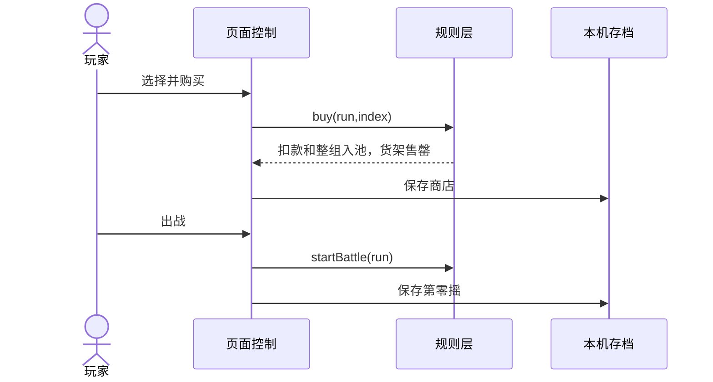
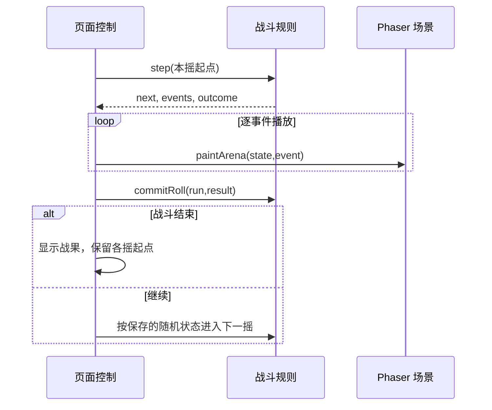

# ROLLBOUND 网页原型设计方案

本版以三间商店和三场战斗验证八方向相邻联动、牺牲成长和战后补强。试玩者打开网页即进第一间商店。每局至少两胜通关，三战都能打完。

## 第一章　UED 与玩法

### 页面与状态

| 页面 | 内容 | 操作与流转 |
| --- | --- | --- |
| 商店 1、2、3 | 金币、三个货架、套组明细、购买后阵容数量、现有队伍、下战敌人 | 点卡预览再招募，可购买多张。售罄和金币不足有明确状态，备战完成进入当场战斗 |
| 战斗 | 双方 3×3 轮盘、共享战场、双方在场单位数、摇号、当前事件 | 默认自动推进；暂停、单步、1/2/4 倍速、战报和快速结算 |
| 战果 | 在场单位数、胜负、本场摇数和阵亡数 | 逐摇回看或进入下一店。进入第二、第三店时各得3金 |
| 总结 | 三场胜负、最终阵容和总胜场 | 再来一局，重新生成种子 |

开局5金，木盾卫士和见习弓手各两枚。第一店出售医师3金、暮王与两名侍从5金、卫士2金。后两店分别生成续航、牺牲、基础三个货架。商店间保留余额。阵亡棋子和生命在新一战开始时恢复，护盾清空。己方见习弓手和暮王的攻击力成长跟随各自的棋子，保留至本局结束。

敌阵依次为两兽人一骨弓、两兽人两骨弓、暮王与两侍从一兽人两骨弓。阵容超过九枚时，出战者含之前已召唤但本摇未点亮的存活单位。

### 轮盘与战斗

每个实例属于一名玩家、占一个格。每摇从存活池等概率无放回抽取最多9枚，随机排入九宫格，所有上盘棋子各点亮一次。未占格为界面底板。首次点亮召唤，以后每次点亮普攻一次。一枚单位在同摇最多出现一次。未上盘的已召唤单位留场，可被选为攻击目标。

1. 停盘并显示双方当前格子。
2. 召唤本摇首次点亮的单位，全部新单位可参与联动。
3. 按本轮盘面计算相邻。共边和共角都算，本格不算。医师随机治疗一个相邻、在场、存活的受伤单位。
4. 按轮盘顺序逐次结算普攻。每次出手时，从当前在场的存活敌人中等概率选一个目标。木盾卫士执行普攻时获得2点护盾。无有效目标时跳过该次攻击。
5. 致死一击后立即结算阵亡并播放退场。阵亡者退出本场，跳过本摇尚未执行的攻击。在场且存活的暮王会在纸甲侍从阵亡时立刻成长。后续攻击重新从仍存活的敌人中选目标，下摇使用更新后的棋子池。
6. 第2摇起，每摇阵亡结算完毕后，场上没有存活单位的一方落败。若双方同时全灭，或打满100摇仍各有在场单位，则记平局。平局计零胜。

| 单位 | 生命 | 攻击 | 特效 |
| --- | ---: | ---: | --- |
| 木盾卫士 | 12 | 2 | 攻击时，自身获得2点护盾。 |
| 见习弓手 | 7 | 3 | 每摇与至少一名木盾卫士相邻时，攻击力+1，保留至本局结束。 |
| 战地医师 | 8 | 1 | 为一个随机受伤的相邻友方单位恢复3点生命值。 |
| 暮王 | 12 | 3 | 每有一个纸甲侍从死亡，场上存活的暮王攻击力+2，保留至本局结束。 |
| 纸甲侍从 | 3 | 1 | 普通攻击。 |
| 兽人 | 10 | 3 | 普通攻击。 |
| 骨弓手 | 7 | 2 | 与兽人相邻时，本轮攻击力+2。 |

### 视线与移动端

桌面战场居中，己方与敌方轮盘分置两侧。手机把两个轮盘并排放在战场上方。滚盘、召唤、联动、攻击、死亡分拍播放；联动阶段与普攻阶段分别先读己方盘、再读敌方盘，每个盘从左到右逐行向下结算。每次联动将发起者与所有参与的相邻棋子放在同一拍，图标保持朝向，同步沿半径 3 像素的圆移动一周，1× 下用时 360 毫秒。战场描出联系线，只有实际受益者显示数值。普攻在 1× 下每击 160 毫秒，由战场动作和命中闪白表现；轮盘保持静止。死亡播放倒下动作。单步可读相同一摇中敌我双方的配合。

商店在手机竖屏使用横向卡片和置底出战按钮。可以点击阵容头像查看卡文、点击战场角色查看当前属性。关闭详情回到之前的播放状态。浏览器切至后台时自动暂停。减少动态效果偏好下角色使用静态帧。

## 第二章　工程技术

### 目录与职责

| 路径 | 主要职责 |
| --- | --- |
| web/src/data.ts | 七种棋子、售价、套组、关卡 |
| web/src/engine.ts | 数据结构、确定性随机数、商店、轮盘、战斗、局内推进 |
| web/src/main.ts | 页面与用户命令、播放进度、存档、战果回看 |
| web/src/arena.ts | 按需加载 Phaser Canvas，播放角色动画和技能指向 |
| web/src/landscape.ts、style.css | 程序绘制的场景底板、响应式布局、状态样式 |
| web/scripts/prepare-art.mjs | 从 Assets/Game/Art 裁取角色头像和待机、攻击、阵亡序列 |
| web/tests/battle.test.mjs | 核心规则回归和多种子三战测试 |
| web/package.json、vite.config.ts | 构建命令、依赖与相对静态资源路径 |

### 数据与时序

Run 保存 seed、stage、金币、永久阵容、货架、余额、胜负和最近一战各摇起点。Battle 保存随机状态、每个单位的实例 id、生命、护盾、成长、是否在场与盘面。Moment 保存阶段名、聚焦实例、伤害或治疗、该事件对应的显示状态。一摇算完后播放，暂停与倍速只控制表现。确认该摇播放完成或快速结算时才更新检查点。刷新回到最近已提交的位置。

### 发布与验收

Node 24，TypeScript、Phaser 3、Vite。web/ 下运行 npm ci、npm test、npm run build。web/dist/ 是独立静态文件，可部署至仓库子路径。主分支保留 Unity 资产与网页源码，发布分支 gh-pages 根目录只放静态成品。角色和游戏脚本都从站点本身加载。

验收覆盖三次购买阶段、三场正常／快速结算、不同种子回放一致、斜角相邻、同名不同实例、双方侍从阵亡、第2摇起的清场胜负与盾卫攻击加盾、触屏竖排操作与页面刷新。数值为首测配置；后续种族和魔法标签可由内容表扩充。
